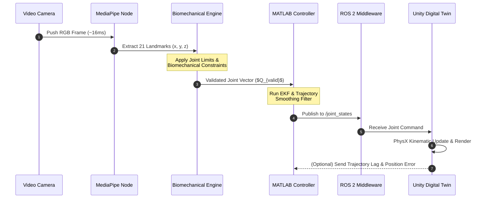

## Project details:

> ![INFO]
>
> **Project name:** Real-time Hand-Gesture Tracking and Control
>
> **Techique:** Digital-twin
> 
> **Author:** Jedi (Pham Ngoc Huy)
>
> **Major**: Electrical Computer Engineer

_**Tech-stacks**_: 
 - MediaPipe, CV2
 - Deep Learning (MLP - with `n` hidden layers)
 - Python
 - Unity (3D Sketch Model)
 - Matlab/C++ (Controlling Theory and Signal Monitoring)
 - ROS2 (Model deployment)

## Workflow-expectation:

TBC
--

