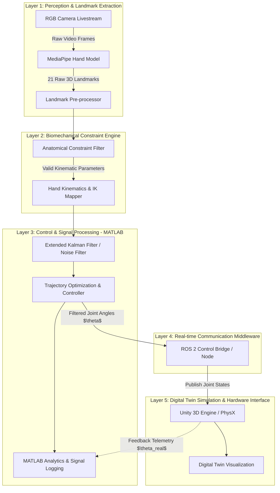
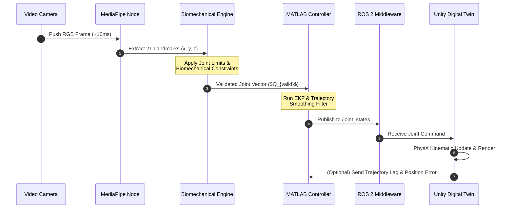

# System Design Specification: Generic Biomechanical Digital Twin & Control Framework
**Project Focus:** Real-time Hand-Gesture Tracking & Control (Capstone / Thesis 1)  
**Author:** Master Student in ECE  

---

## 1. Executive Summary & Architectural Vision

System này được thiết kế theo mô hình **Modular & Layered Architecture** (Kiến trúc phân lớp và đóng gói module) dành cho bài toán điều khiển Sinh cơ học (Biomechanical Control) thời gian thực.

Mục tiêu chính của Capstone (Thesis 1) là thiết lập một **Framework xử lý tín hiệu và mô phỏng số (Digital Twin)** hoàn chỉnh từ nguồn dữ liệu thị giác thô (Vision-based Landmark Detection) đến mô hình vật lý ảo (Unity PhysX) thông qua hạ tầng ROS 2 và MATLAB.

---

## 2. High-Level System Architecture

Sơ đồ tổng thể kiến trúc gồm 5 tầng chính (5-Layer Pipeline). Mọi dữ liệu luân chuyển một chiều từ Sensing đến Simulation, ngoại trừ luồng Telemetry Feedback từ Unity quay về MATLAB phục vụ việc phân tích lỗi quỹ đạo (Trajectory Error Analysis).

---

## 3. Detailed Subsystem Description

### 3.1. Layer 1: Perception & Landmark Extraction
* **Function:** Thu thập frame hình ảnh trực tiếp từ Webcam và trích xuất tọa độ 21 điểm mốc (Hand Landmarks) trong không gian $3D$.
* **Input:** RGB Video Stream ($\ge 30$ FPS).
* **Output:** Tập tọa độ thô $P_{raw} = \{p_1, p_2, ..., p_{21}\} \in \mathbb{R}^3$.
* **Challenge Addressed:** Nhiễu góc quay (Occlusion) và biến thiên độ sâu không chính xác của MediaPipe ($z$-depth ambiguity).

### 3.2. Layer 2: Biomechanical Constraint Engine
* **Function:** Áp dụng mô hình sinh cơ học bàn tay để lọc bỏ các cấu hình ngón tay không tự nhiên (Anatomically Impossible Poses).
* **Core Logic:**
  * Giới hạn góc gập/duỗi (Flexion/Extension limits) của các khớp MCP, PIP, DIP.
  * Phụ thuộc động học giữa khớp PIP và DIP: $\theta_{DIP} \approx \frac{2}{3} \theta_{PIP}$.
* **Output:** Vector góc khớp đã qua kiểm định sinh học $Q_{valid} \in \mathbb{R}^{15}$.

### 3.3. Layer 3: Control & Signal Processing (MATLAB)
* **Function:** Lọc nhiễu thời gian thực, ước lượng trạng thái động lực học và tính toán tín hiệu điều khiển mượt mà.
* **Algorithms:**
  * **Extended Kalman Filter (EKF):** Loại bỏ jitter/nhiễu rung từ camera.
  * **Low-pass Filter / Trajectory Smoother:** Đảm bảo vận tốc và gia tốc góc khớp không vượt quá ngưỡng mô-men vật lý.
* **Math Model:**
  $$x_k = f(x_{k-1}) + w_k, \quad z_k = h(x_k) + v_k$$
  Trong đó $x_k = [\theta, \dot{\theta}, \ddot{\theta}]^T$ là trạng thái động học góc khớp.

### 3.4. Layer 4: Middleware (ROS 2)
* **Function:** Môi trường truyền thông thời gian thực giữa MATLAB Controller và Unity Digital Twin.
* **Topics & Nodes:**
  * Node: `/hand_biomech_controller`
  * Topic: `/joint_states` (`sensor_msgs/msg/JointState`)
  * Topic: `/telemetry_feedback` (`custom_msgs/msg/HandFeedback`)

### 3.5. Layer 5: Unity Digital Twin
* **Function:** Mô phỏng tương tác vật lý thời gian thực, hỗ trợ trực quan hóa cử động và đánh giá độ trễ.
* **Engine:** Unity PhysX + ROS-TCP Connector package.

---

## 4. Real-time Data Flow & Latency Pipeline

Sơ đồ trình tự biểu diễn vòng lặp điều khiển thời gian thực (Real-time Control Loop) và kiểm soát độ trễ (Latency Minimization).

