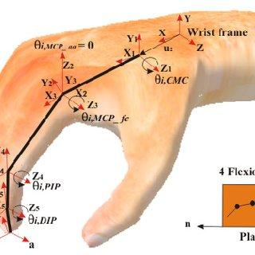

# Axis of Rotation

Ref: `Cerveri Biomechanical Model`

`Axis of Rotation (AoR):` được xác định bằng các `relationship` (coordinate system)

| Coordinators | Origin                              | X-axis                                 | Y-axis                                | Z-axis                                      |
| ------------ | ----------------------------------- | -------------------------------------- | ------------------------------------- | ------------------------------------------- |
| Root         | Geometrical center wrist            | quy tắc bàn tay phải dứa trên y và z   | pháp tuyến mặt phẳng 4 markers cổ tay | đường nối 2 markers theo chiều dọc          |
| Wrist        | Tâm cổ tay                          | quy tắc bàn tay phải                   | đường nối tâm cổ tay -> MCP ngón giữa | pháp tuyến mặt phẳng lòng bàn tay           |
| MCP          | Dịch nửa độ dày khớp từ marker      | pháp tuyến mặt phẳng (MCP, PIP, DIP)   | tự động theo trục X & Z               | Hướng tịnh tiến vào tâm khớp                |
| PIP          | Dịch nửa độ dày khớp từ marker      | Kế thừa từ khớp MCP tương ứng          | Tự động theo trục X & Z               | Dọc theo chiều dài đốt ngón                 |
| DIP          | Dịch nửa độ dày của khớp từ markers | Pháp tuyến mặt phẳng (TM, MCP, IP, FT) | Tự động theo trục X & Z               | Dựa vào marker phụ $M_{a}$ (đo độ xoáy sấp) |

## `X-axis` có phải lấy MCP rồi chiếu lên PIP/DIP không?

Trong implementation `VirtualLocalFrame` của chúng ta, quy tắc đã thiết kế là:

- **Proximal X**: được xác định từ mặt phẳng hình học.
- **Intermediate X**: kế thừa Proximal X.
- **Distal X**: kế thừa Proximal X.

> - Vì vậy, nếu đã kế thừa X-axis theo thiết kế này thì không cần thực hiện phép chiếu X-axis của MCP lên PIP/DIP thêm lần nữa
> - Việc đó có thể làm thay đổi hướng trục mà không có lý do hình học cần thiết.

## `Z-axis` có luôn hướng xuống không?

Không hoàn toàn. Z-axis là hướng longitudinal của segment. Khi biểu diễn trong Hand Root coordinate system, nó có thể hướng khác nhau tùy theo pose và finger.

| Axis | Ý nghĩa                                                        |
| ---- | -------------------------------------------------------------- |
| X    | `Flexion-extension` rotation axis, theo convention của mô hình |
| Y    | Trục còn lại để hoàn thành hệ tọa độ trực chuẩn                |
| Z    | Hướng dọc phalanx/segment                                      |

## Tại sao chúng ta chọn `X-axis` làm `AoR direction` ?

## Tại sao `Intermediate/Distal` frames sử dụng X-axis kế thừa từ `Proximal` frame?
