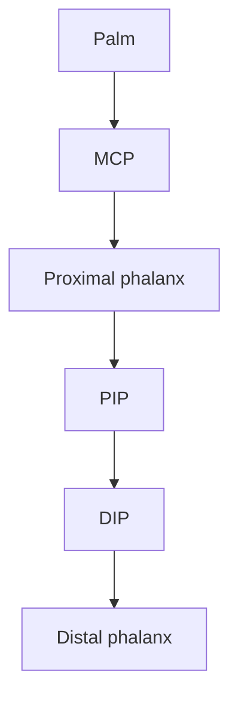
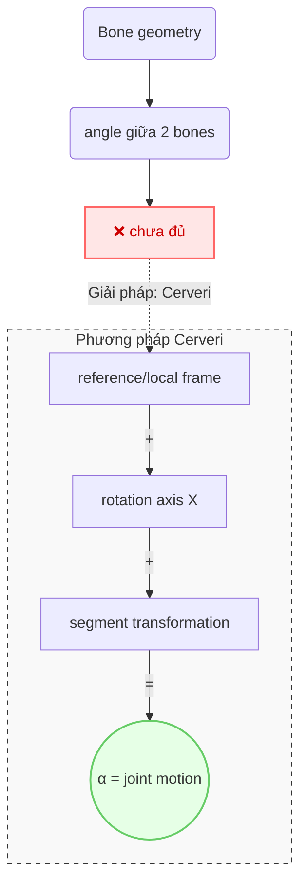

# Day 5

## Objective:

Ứng dụng Cerveri model để phát triển Virtual Sensor và thực hiện programming

Trả lời được câu hỏi
> Từ mediapipe 21 landmarks $\rightarrow$ làm thế nào để lấy được joint angles $\rightarrow$ đưa ra joint angles vào một kinematic hand model

## Processing:

### Part 1: Container "Cerveri model"

từ paper của Cerveri, có kết luận rằng:

hand = hierarchical rigid-body system

Mỗi anatomical distinct có:
- vị trí
- orientation
- hirerachy
- marker positions
- kinematic variables
- geometric properties

**Ví dụ**: với 1 ngón tay



> [!Note]:
> Trong mô hình 21 điểm (landmarks) chuẩn của `MediaPipe`, lòng bàn tay không phải là 1 điểm đơn lẻ, mà là **mặt phẳng cơ sở (palm landmarks)** được tạo bởi các điểm gốc

### Bài toán cơ sở:

Ta lấy: `PIP Joint`

Ví dụ index finger


ta đang muốn tìm 

```math
\theta_{PIP}
```
Cerveri biểu diễn 1-DoF rotation bằng rotation matrix quanh một local axis. Paper đang viết marker relation dưới dạng:

```math
P_{p} = R_{1DoF}(X,\alpha) P_{t}

```
và sau đó expand rotation matrix để tìm $\alpha$

> Điều này khá thuận lợi khi áp dụng `MediaPipe` khi đó chúng ta đã có trực tiếp 3D coordinates của các landmarks. Implement bước đầu sẽ dễ hơn

### Cerveri cần trong coordinate system.

Nếu chỉ dùng:

```math
MCP \rightarrow PIP \\
PIP \rightarrow DIP
```

thì mình chỉ đang biết **hai bone đang tạo với nhau bao nhiêu góc.**

```math
\overrightarrow{PIP\rightarrow DIP} \\
\\
\text{hay} \\
\\
\overrightarrow{DIP\rightarrow PIP} 
```

>[!NOTE] 
>
> Công thức thông thường xử lí:
>
> ```math
>  \theta = \cos^{-1}
>  \left(\frac{\vec{v_1} \cdot \vec{v_2}}{|\vec{v_1}| |\vec{v_2}|}\right)
>
> ```

nhưng mình không biết đó là

> nó đang là `flexion` hay đang `abduct`?

$\rightarrow$ Cerveri xây dựng `local coordinate system` cho từng **anatomical district**. Paper mô tả các coordinate axes được xác định từ **marker geometry** và dùng chúng để biểu diễn motion của từng segment.

_Ví dụ_:

```bash
            Y
            |
            |
            |
MCP ------- PIP
 \
  \ 
   DIP
```

Ta cần định nghĩa:

```bash
local X = flexion axis
local Z = another anatomical axis
local Y = remaining orthogonal axis
```

Sau đó rotation trở thành:

```math

R(X, \theta)
```

Where:

$X$: là local rotation axis
$\theta$: là rotation angle quanh axis đó 

hoặc với joint 2-DoF:

```math
R(X, \alpha) R(Z, \beta)
```
Where:

$\alpha$: flexion rotation angle
$\beta$: abduction rotation angle
$X$: intersect axes
$Z$: orthogonal axes

Nói cách khác:



### Local coordinate frame

Ceveri đặt rất nhiều emphasis vào việc xác định direction của rotation axes và vị trí tương đối của các joint center trong calibration

> Một cái frame 3D thực chất là cái gì ?

Nó chính là 3 vectors đơn vị -- `vuông góc với nhau`:

```math
\boxed{
    \hat{x}, \hat{y}, \hat{z}
}
```

$\rightarrow$ áp dụng vào mediapipe landmarks

MediaPipe cho

```math

P_{MCP}, P_{PIP}, P_{DIP}, P_{TIP}

```

thông thường lấy X = {1,0,0} $\rightarrow$ đây lại là global X-axis

> cái mình muốn lại là local X-axis của finger

**Longitudinal direction**:

ta định nghĩa:

```math

\vec{x_{raw}} = P_{TIP} - P_{MCP}

```
rồi normalize:

```math
\boxed{

    \hat{x} = \frac{P_{TIP} - P_{MCP}}{||P_{TIP} - P_{MCP}||}
}

```

Lúc này, ta lấy `TIP - MCP` là đại diện cho hướng 

longitudinal tổng thể của finger, thay vì chỉ lấy 1 phanlanx

Ví dụ:

- PIP - MCP $\rightarrow$ hướng của proximal phalanx
- DIP - PIP $\rightarrow$ hướng của middle phalanx
- TIP - MCP $\rightarrow$ hướng tổng thể của toàn finger

Với mục tiêu dựng một finger-level local frame, TIP - MCP là một lựa chọn trực quan.


Paper nói về việc calibrate directions of the rotation axes và relative positions of joint centers dựa trên marker configuration.

Vì vậy trong project của mình, ta đang làm một Cerveri-inspired simplification:

```math
\boxed{\text{finger longitudinal direction} \approx TIP-MCP}
```

chứ chưa được gọi nó là Cerveri's anatomical rotation axis.


**Tại sao chỉ biết $\hat{x}$ vẫn chưa đủ để xác định orientation 3D của finger ?**

Ví dụ:

```math
\hat{x}= 
\begin{bmatrix} 
1\\
0\\
0 
\end{bmatrix}
```
thì sau khi xoay fingẻ quanh $x$ một góc $\phi$, vẫn
```math
\hat{x}'= 
\begin{bmatrix} 
1\\
0\\
0 
\end{bmatrix}
```

Đây chính là vấn đề:

```math
\boxed{\text{rotation around }x \text{ cannot be detected from }x\text{ direction alone}}
```

> và đây cũng chính là lý do ta cần axis thứ 2

Ta đã có: $\hat{x}$

Giờ giả sử ta có thêm một vector: $\vec{v}$

chẳng hạn một hướng liên quan đến palm.

Ta có thể dùng nó để xác định một mặt phẳng chứa finger và reference direction.

Sau đó cross product:

```math
\hat{z} = \hat{x}\times\hat{v}
```

cho ta một hướng vuông góc với mặt phẳng đó.

Rồi:

```math
\hat{y} = \hat{z}\times\hat{x}
```

$\rightarrow$ cuối cùng:

```math
\boxed{ (\hat{x},\hat{y},\hat{z}) }
```

là local coordinate frame.